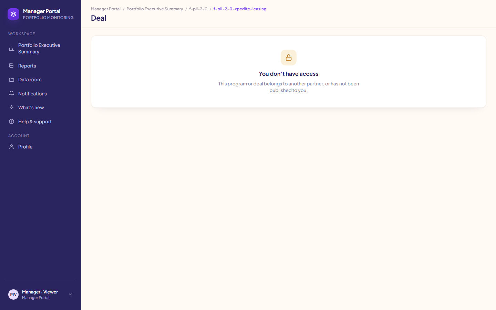
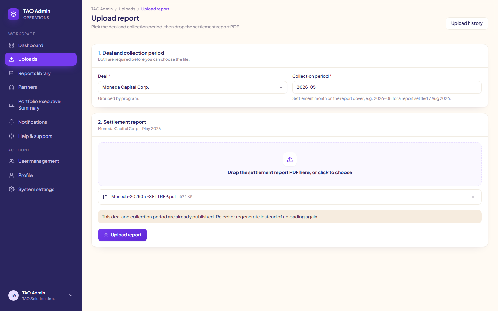
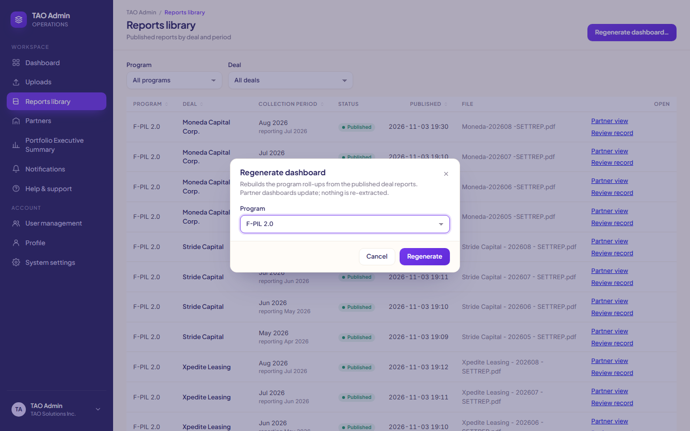
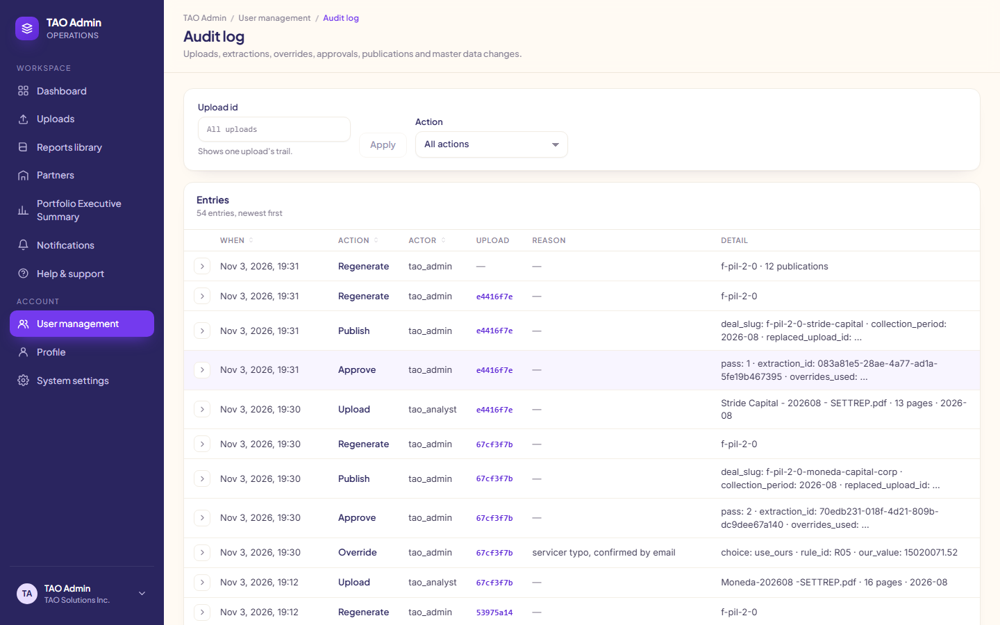
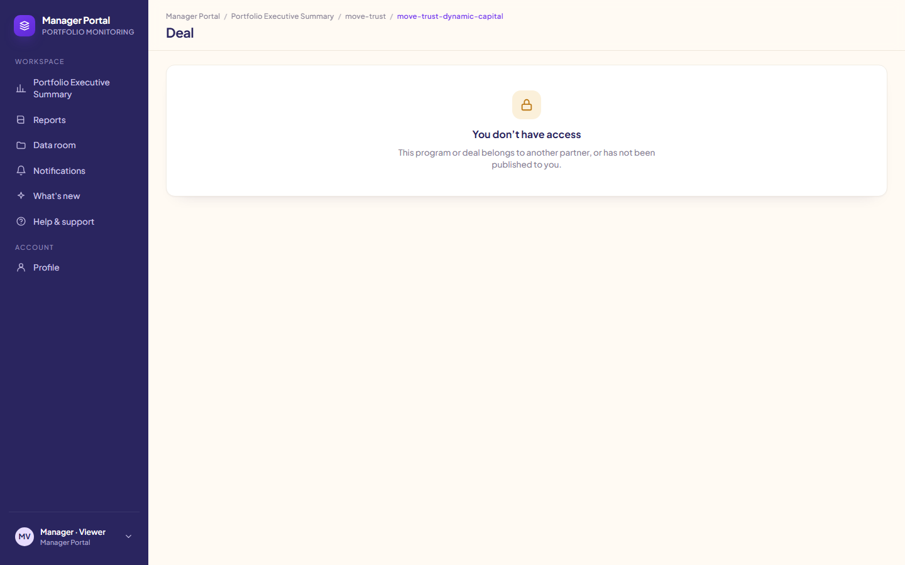

# TAO Admin POC — demo walkthrough

The build plan's demo script (section "Demo script and acceptance", steps 1–7), run in order from a fresh database,
with the screenshots the Playwright tests capture on every run (`docs/demo/*.png`). Each step below is one test in
`tests/e2e/specs/`; the negative tests sit between the steps where their state exists. Every number here comes from
the real SetRep PDFs in `data/samples/` and the shared dashboard objects in `docs/dashboard-json/`.

## Run it

On a clean Windows machine with Docker Desktop, Node 20+, Python 3.11+ (`pip install httpx pypdf`) and Git Bash:

```sh
cp .env.example .env                        # fill in ANTHROPIC_API_KEY
# put the 12 SetRep PDFs in data/samples/ (Moneda, Stride, Xpedite, 202605-202608)
docker compose up -d --build
docker compose exec api python -m app.seed  # Git Bash: prefix MSYS_NO_PATHCONV=1 if a path argument is mangled
cd tests/e2e
npm ci
npx playwright install chromium
npm run test:e2e                            # setup + the seven steps + negatives, about 8 minutes
npm run lighthouse                          # optional: accessibility on the four main pages, after test:e2e
```

The tests read `E2E_WEB_URL` (default `http://localhost:5173`) and `E2E_API_URL` (default `http://localhost:8000`).
For a private stack beside the default one (the agent setup), from the repo root:

```sh
export API_PORT=18500 WEB_PORT=15500
docker compose -p tao-qa -f docker-compose.yml -f scripts/compose.agent.yml up -d --build
docker compose -p tao-qa -f docker-compose.yml -f scripts/compose.agent.yml exec -T api python -m app.seed
cd tests/e2e && E2E_WEB_URL=http://localhost:15500 E2E_API_URL=http://localhost:18500 npm run test:e2e
```

**Reset.** The demo needs a fresh database: the setup test stops with a clear message if Xpedite, Moneda or Stride
2026-08 has already been uploaded. Reset with `docker compose down -v`, then `up -d` and the seed again (add
`-p tao-qa -f docker-compose.yml -f scripts/compose.agent.yml` for the private stack).

**What the setup does.** `tests/e2e/setup/demo.setup.ts` checks the stack is up, seeded and fresh, builds the
seeded-error PDF with the Lead's tool (`scripts/demo_data.py: seeded_moneda_aug`, one digit changed on page 2 of
Moneda 202608), and publishes May–July for Moneda, Xpedite and Stride through the HTTP API, the way a previous
month-end would have left the system. Xpedite's June and July reports revise earlier months (R11 restatements that
the reference object also records); the setup accepts them as a reviewer would.

Other scripts: `npm run test:e2e:wave3` runs the same plus the wave-3 assertions (below); `npm run report` opens the
last HTML report.

## Journey 1 — a clean report, from upload to the investor portal

### Step 1. TAO Analyst uploads a SetRep

Signed in as TAO Analyst through the sidebar user card: Uploads › Upload report, deal Xpedite Leasing (F-PIL 2.0),
collection period 2026-08, drop `Xpedite Leasing - 202608 - SETTREP.pdf`.


The status moves Received › Extracting › Needs review while the page polls every 2 seconds. The reporting period read
from the page header is Jul 2026, one month before the collection period (rule R04). No findings.


The Approval queue lists it with its finding count ("No findings").


### Step 2. TAO Admin reviews and publishes

Switched to TAO Admin: Approval queue › Xpedite Leasing. No finding cards ("No findings. Every rule passed for this
extraction."). Every extracted value carries its page link (`p. N`), or names the earlier publication it was carried
from; 94 page links, 0 values without a source.


A page link opens the page image at that value.


Publish to partner › Approve and publish. The status becomes Published, the Activity card and the Audit log show
Approve and Publish by `tao_admin`.


### Step 3. Investor Viewer sees the deal; the numbers match the shared dashboard

Switched to Investor · Viewer: Portfolio Executive Summary › F-PIL 2.0 › Open deal Xpedite Leasing.


The test reads every number on the deal page (154 values carrying `data-field`) and compares each with the
published object and with `docs/dashboard-json/f-pil-2-0-xpedite-leasing.dashboard.json`: 0 mismatches, largest
money difference $0.00; the tranche roll-forward matches to the cent. The deal offers four periods (2026-05 to
2026-08).

The Manager partner does not see F-PIL 2.0 today, so the same deal URL in the Manager portal shows "You don’t have
access" and the API returns no data. Once programs are shared with both partners (wave 3), the manager sees the same
numbers; that is asserted in `tests/e2e/wave3/`.



## Journey 2 — a report with an error

### Step 4. TAO Analyst uploads the seeded-error report

The copy of Moneda 2026-08 with one digit changed on page 2 (scheduled principal 646,926.71 → 646,826.71). Status
needs review with one Block finding, R05 Tranche balance roll-forward: ours $15,020,071.52, report
$15,019,971.52, difference −$100.00, tolerance ±$1.00, with the roll-forward terms and the page 2 crop. The second
pass has already run (Extraction: Pass 2, re-read page 2). The analyst's view is read only.


**Negative tests on this state.** The analyst cannot resolve, reject or publish: no buttons in the UI, and the API
answers 403 `admin_only` to approve, override and reject. As TAO Admin, Publish to partner is disabled with "1 block
finding is open. Resolve it before publishing.", and the API answers 409 `open_block_findings` naming R05.


### Step 5. TAO Admin overrides with a reason and publishes

Use ours for R05, reason "servicer typo, confirmed by email", Save and re-run rules. The rules re-run, R05 shows
"Used our value" with the reason, no block finding is open, Publish to partner › Approve and publish. The Audit log
shows the Override with its reason, then Approve (listing the override used) and Publish.


Today the published closing stays the report's $15,019,971.52. When "Use ours" writes the chosen value into the
published deal (wave 3), it becomes $15,020,071.52 with a `data_corrections` entry; asserted in `tests/e2e/wave3/`.

## Journey 3 — the next month and a regeneration

### Step 6. TAO Analyst uploads the following month

Stride Capital 2026-08, after Stride 2026-07 is published. No R11 finding: the extracted opening balance and
opening contracts equal July's published closing. Two R14 review findings, no block; TAO Admin publishes it. The
F-PIL 2.0 program dashboard now shows 3 deals for August 2026.


Not shown: "the covenant status change raises an in-app toast". None of the three F-PIL reference objects has a
covenant status change from July to August, and the app has no covenant-change toast (filed in `docs/requests.md`).

### Step 7. TAO Admin regenerates the dashboard

The script says to re-upload month one first. The API refuses a second upload for a published deal and period
(409 `already_published`, R12: "reject or regenerate instead"), and the Upload report page says so.



Reports library (12 published reports) › Regenerate dashboard…, program F-PIL 2.0 › Regenerate: "F-PIL 2.0: rebuilt
from 12 published reports." The roll-up totals are unchanged (nothing changed underneath) and the Audit log records
a manual Regenerate by `tao_admin`.





## Negative tests (tenancy and failure)

- A partner sees only its own programs. For every program a partner does not own (today: both programs for the
  Manager), the program, dashboard and deal URLs show "You don’t have access" and the API returns 403 / 404 with no
  deal data. A partner role that types the other partner's portal URL is sent back to its own portal, and claiming
  the other partner in `X-Partner` is refused (403 `bad_partner`).
- Partner roles get 403 on `/uploads`, `/audit`, `/master/*` and regenerate, and `/admin` URLs send them back to
  their portal. An analyst gets "You don’t have access" on Partners and 403 on `/audit`.
- A blank PDF ends in `extraction_failed`; the page says "Extraction failed. Check the audit log for the reason,
  then upload the file again." and the audit reason reads "page 1 has no text layer; cover block not found (no page
  has text: scanned or blank PDF, OCR fallback not built yet)". The test rejects it afterwards.




## Acceptance (build plan), measured 2026-11-03

Measured on the QA stack (Windows 11, Docker Desktop) from `docker compose down -v`, with `npm run test:e2e`.

| Criterion | Pass | Measured |
| --- | --- | --- |
| Both sample SetReps extract with no null required field | Yes / No | Yes for the F-PIL template: all 12 F-PIL PDFs reach needs review (9 in setup, 3 in the steps); the schema validation is the Extraction agent's suite. No MOVE Trust SetRep exists to test. |
| Rules 1–18 each have a passing and a failing fixture and run in under 2 s | Yes / No | Pass and fail fixtures for R01–R15, R17–R19 under `rules/tests/fixtures/`; R16 (program-level SetRep) has none because no such SetRep exists. Timing is the Rules suite's `test_reference_findings_validate_and_run_fast`. |
| Published deal page equals the shared dashboard for the same deal and period | Every metric within $1 / 0.01 pp | Yes. Xpedite Leasing 2026-08: 154 numbers on the page, 0 mismatches against the published object and the reference, largest money difference $0.00. |
| A partner role cannot reach another partner's data by URL or API | Verified by test | Yes: `specs/08-negatives.spec.ts` (4 tests) and step 3. |
| Time from upload to needs review on a 20-page SetRep | Under 3 minutes | Yes. 6–32 s per report (13–17 pages): Stride 6–16 s, Moneda 18–29 s, Xpedite 28–32 s; the seeded Moneda with its second pass 29 s. |
| Every number on the Review report has a page reference | 100% | Yes. Xpedite 2026-08: 94 page links, 8 values carried from the July publication (labelled so), 0 "no source"; 27 of 27 key-value rows referenced. |
| Lighthouse accessibility on the four main pages | 90 or higher | Yes. TAO Admin dashboard 96, Review report 93, Portfolio executive summary 96, Deal page 96. Failures: colour contrast (all four), and on Review report `label-content-name-mismatch` (page links) and `target-size`. |
| Full demo from `docker compose up` on a clean Windows machine | Under 10 minutes including seed | No, 11 min 17 s: stack build, start and seed 3 min 18 s; tests 8 min (setup publishing May–July for three deals 3 min 24 s, the seven steps and negatives about 4 min). Web dependencies were already in `web/node_modules`, so a first start adds the container's `npm install`. With images already built, start and seed took 1 min 18 s, about 9 min 20 s in all. |

**Known issue (open).** One of two full clean runs failed at step 4: two page images rendered at the same moment
crashed the API server process (PDFium is not thread-safe), and every later test timed out. Restart the API
(`docker compose restart api`) and rerun the remaining specs with `npx playwright test specs/04b specs/05 specs/06
specs/07 specs/08 --project=demo --no-deps`. Filed to Data & API in `docs/requests.md`.

Per-report extraction times are written to `tests/e2e/.cache/measurements.jsonl` on every run.

## Wave-3 assertions (`tests/e2e/wave3/`, `npm run test:e2e:wave3`)

Written against the wave-3 contract and expected to fail until that work is merged:

- Both programs list investor and manager in `partner_slugs`; `GET /master/partners` answers 200 for TAO roles and
  403 for partners.
- Every covenant definition carries `unit` (fraction, ratio, currency).
- The Manager Viewer sees F-PIL 2.0 and the same Xpedite 2026-08 numbers as the investor, matching the reference.
- After step 5, R05 carries `targets`, the published Moneda 2026-08 closing is $15,020,071.52, the deal page shows
  $15,020,072, and `data_corrections` holds old 15,019,971.52 → new 15,020,071.52 with the reason.

When change (1) lands, the Manager no-access check in step 3 and in the tenancy test has no hidden program to try and
records that as an annotation instead of failing.
