# TAO Admin: portal & page map

This application will provide trend tracking and analysis for all three groups on the trends on portfolio performance, financial performance. The three groups being the investor, the manager of the portfolio and Tao admin.

## Portals
- TAO Admin (main app, full access)
  - Used by: The TAO team
  - Roles: Admin, Analyst
  - Sign-in required: Yes · first page: Sign in · home: Portfolio Executive Summary
- Investor Portal (partner portal, connects into TAO Admin)
  - Used by: Investor
  - Who uses it: only this partner
  - Roles: Company Admin, Viewer
  - Sign-in required: Yes · first page: Sign in · home: Portfolio Executive Summary
- Manager Portal (partner portal, connects into TAO Admin)
  - Used by: Manager
  - Who uses it: only this partner
  - Roles: Company Admin, Viewer
  - Sign-in required: Yes · first page: Sign in · home: Portfolio Executive Summary

## Accounts
- Who creates accounts for people at partners like BDC and 990 Capital? TAO creates each partner’s first admin, who invites their own team
- How do people sign in? Email and password
- Do people need a second check when they sign in, such as a code on their phone? Yes, in every portal
- Can one person belong to more than one partner? No, one person, one partner
- Can the TAO team open a partner’s portal and see exactly what that partner sees? Yes, read-only
- When a partner stops using its portal, what happens? Turn off access, keep their data

## Where each page lives
- TAO Admin
  - Before sign-in
    - Sign in
    - Forgot password
    - Two-step verification
  - Main menu
    - Portfolio Executive Summary (home)
      - MOVE Trust Executive Summary
        - MOVE Trust Dashboard
          - Portfolio Metrics
          - Covenant Status & Review
            - Deal covenant detail (pop-up)
            - Watch threshold setting (pop-up)
          - Print / Save as PDF (pop-up)
      - F-PIL 2.0 Executive Summary
      - F-PIL 2.0 Dashboard
        - Deal page
          - Deal Metrics
      - Deal picker (pop-up)
    - Dashboard
    - Notifications
    - Help & support
    - Search results
    - Partners
      - Partner details
        - View as partner
        - Partner permissions
    - Uploads
      - Upload report
      - Upload history
      - Approval queue
        - Review report
          - Reject report (pop-up)
          - Publish to partner (pop-up)
    - Reports library
      - Report viewer
      - Regenerate dashboard (pop-up)
  - Account & settings
    - User management
      - Audit log
      - Roles & permissions
      - Add user (pop-up)
    - Profile
      - Change password
      - Notification preferences
    - System settings
  - Shown automatically
    - Confirm delete (pop-up)
    - Unsaved changes (pop-up)
    - Confirm sign out (pop-up)
    - Saved successfully (pop-up)
    - Terms & privacy (pop-up)
    - Page not found
    - You don’t have access
    - Session timed out
    - No reports yet
    - Maintenance
    - Account deactivated
- Investor Portal
  - Before sign-in
    - Sign in
    - Forgot password
    - Two-step verification
  - Main menu
    - Portfolio Executive Summary (home)
      - MOVE Trust Executive Summary
        - MOVE Trust Dashboard
          - Portfolio Metrics
          - Covenant Status & Review
            - Deal covenant detail (pop-up)
            - Watch threshold setting (pop-up)
          - Print / Save as PDF (pop-up)
      - F-PIL 2.0 Executive Summary
      - F-PIL 2.0 Dashboard
        - Deal page
          - Deal Metrics
      - Deal picker (pop-up)
    - Home
    - Notifications
    - Search results
    - Help & support
    - What’s new
    - Reports
      - Report viewer
      - Download history
    - Data room
  - Account & settings
    - Profile
      - Change password
      - Notification preferences
    - Team members
      - Invite teammate (pop-up)
      - Remove teammate (pop-up)
  - Shown automatically
    - Confirm delete (pop-up)
    - Unsaved changes (pop-up)
    - Confirm sign out (pop-up)
    - Saved successfully (pop-up)
    - Terms & privacy (pop-up)
    - Page not found
    - You don’t have access
    - Session timed out
    - No reports yet
    - Account deactivated
- Manager Portal
  - Before sign-in
    - Sign in
    - Forgot password
    - Two-step verification
  - Main menu
    - Portfolio Executive Summary (home)
      - MOVE Trust Executive Summary
        - MOVE Trust Dashboard
          - Portfolio Metrics
          - Covenant Status & Review
            - Deal covenant detail (pop-up)
            - Watch threshold setting (pop-up)
          - Print / Save as PDF (pop-up)
      - F-PIL 2.0 Executive Summary
      - F-PIL 2.0 Dashboard
        - Deal page
          - Deal Metrics
      - Deal picker (pop-up)
    - Home
    - Notifications
    - Search results
    - Help & support
    - What’s new
    - Reports
      - Report viewer
      - Download history
    - Data room
  - Account & settings
    - Profile
      - Change password
      - Notification preferences
    - Team members
      - Remove teammate (pop-up)
      - Invite teammate (pop-up)
  - Shown automatically
    - Confirm delete (pop-up)
    - Unsaved changes (pop-up)
    - Confirm sign out (pop-up)
    - Saved successfully (pop-up)
    - Terms & privacy (pop-up)
    - Page not found
    - You don’t have access
    - Session timed out
    - Account deactivated
    - No reports yet

## Shared data & reports
- Portfolio Executive Summary (Live data or a dashboard) — created on TAO Admin › Portfolio Executive Summary; the TAO team approves it before it’s shared
  - → Investor Portal › Portfolio Executive Summary: view, download; only records about their own company
  - → Manager Portal › Portfolio Executive Summary: view, download; only records about their own company
- MOVE Trust — Executive Summary (Live data or a dashboard) — created on TAO Admin › MOVE Trust Executive Summary; the TAO team approves it before it’s shared
  - → Investor Portal › MOVE Trust Executive Summary: view, download; only records about their own company
  - → Manager Portal › MOVE Trust Executive Summary: view, download; only records about their own company
- Portfolio Dashboard — 2026-07 (Live data or a dashboard) — created on TAO Admin › MOVE Trust Dashboard; the TAO team approves it before it’s shared
  - → Investor Portal › MOVE Trust Dashboard: view, download; only records about their own company
  - → Manager Portal › MOVE Trust Dashboard: view, download; only records about their own company
- Moneda Capital Corp. — F-PIL 2.0 deal page (Live data or a dashboard) — created on TAO Admin › F-PIL 2.0 Dashboard; the TAO team approves it before it’s shared
  - → Investor Portal › F-PIL 2.0 Dashboard: view, download; only records about their own company
  - → Manager Portal › F-PIL 2.0 Dashboard: view, download; only records about their own company
- Xpedite Leasing — F-PIL 2.0 deal page (Live data or a dashboard) — created on TAO Admin › Deal page; the TAO team approves it before it’s shared
  - → Investor Portal › Deal page: view, download; only records about their own company
  - → Manager Portal › Deal page: view, download; only records about their own company
- F-PIL 2.0 — Executive Summary (Live data or a dashboard) — created on TAO Admin › F-PIL 2.0 Executive Summary; the TAO team approves it before it’s shared
  - → Investor Portal › F-PIL 2.0 Executive Summary: view, download; only records about their own company
  - → Manager Portal › F-PIL 2.0 Executive Summary: view, download; only records about their own company
- F-PIL 2.0 — Portfolio Dashboard — August 2026 (Live data or a dashboard) — created on TAO Admin › F-PIL 2.0 Dashboard; the TAO team approves it before it’s shared
  - → Investor Portal › F-PIL 2.0 Dashboard: view, download; only records about their own company
  - → Manager Portal › F-PIL 2.0 Dashboard: view, download; only records about their own company
- MOVE Trust & F-PIL 2.0 — All Dashboards (Live data or a dashboard) — created on TAO Admin › Portfolio Executive Summary; the TAO team approves it before it’s shared
  - → Investor Portal › Portfolio Executive Summary: view, download; only records about their own company
  - → Manager Portal › Portfolio Executive Summary: view, download; only records about their own company
- Stride Capital — F-PIL 2.0 deal page (Live data or a dashboard) — created on TAO Admin › Deal page; the TAO team approves it before it’s shared
  - → Investor Portal › Deal page: view, download; only records about their own company
  - → Manager Portal › Deal page: view, download; only records about their own company
- Dynamic Capital — MOVE Trust deal page (Live data or a dashboard) — created on TAO Admin › Deal page; the TAO team approves it before it’s shared
  - → Investor Portal › Deal page: view, download; only records about their own company
  - → Manager Portal › Deal page: view, download; only records about their own company
- Essex Lease Financial Corp. — MOVE Trust deal page (Live data or a dashboard) — created on TAO Admin › Deal page; the TAO team approves it before it’s shared
  - → Investor Portal › Deal page: view, download; only records about their own company
  - → Manager Portal › Deal page: view, download; only records about their own company
- Finloc 2000 Inc. — MOVE Trust deal page (Live data or a dashboard) — created on TAO Admin › Deal page; the TAO team approves it before it’s shared
  - → Investor Portal › Deal page: view, download; only records about their own company
  - → Manager Portal › Deal page: view, download; only records about their own company
- Meridian OneCap LP — MOVE Trust deal page (Live data or a dashboard) — created on TAO Admin › Deal page; the TAO team approves it before it’s shared
  - → Investor Portal › Deal page: view, download; only records about their own company
  - → Manager Portal › Deal page: view, download; only records about their own company
- TLFC (Leases) — MOVE Trust deal page (Live data or a dashboard) — created on TAO Admin › Deal page; the TAO team approves it before it’s shared
  - → Investor Portal › Deal page: view, download; only records about their own company
  - → Manager Portal › Deal page: view, download; only records about their own company
- TLFC (Loans) — MOVE Trust deal page (Live data or a dashboard) — created on TAO Admin › Deal page; the TAO team approves it before it’s shared
  - → Investor Portal › Deal page: view, download; only records about their own company
  - → Manager Portal › Deal page: view, download; only records about their own company
- TLFC LP (Leases) — MOVE Trust deal page (Live data or a dashboard) — created on TAO Admin › Deal page; the TAO team approves it before it’s shared
  - → Investor Portal › Deal page: view, download; only records about their own company
  - → Manager Portal › Deal page: view, download; only records about their own company
- TPine Leasing Capital Corporation — MOVE Trust deal page (Live data or a dashboard) — created on TAO Admin › Deal page; the TAO team approves it before it’s shared
  - → Investor Portal › Deal page: view, download; only records about their own company
  - → Manager Portal › Deal page: view, download; only records about their own company
- VCC IV LP — MOVE Trust deal page (Live data or a dashboard) — created on TAO Admin › Deal page; the TAO team approves it before it’s shared
  - → Investor Portal › Deal page: view, download; only records about their own company
  - → Manager Portal › Deal page: view, download; only records about their own company

## Decision points
- On TAO Admin › Upload report: Did the upload pass validation?
  - Yes → TAO Admin › Approval queue
  - No, show errors → TAO Admin › Upload report

## Journeys
- TAO analyst uploads a report and publishes it to a partner — Admin; goal: The right partner sees the approved report
  1. TAO Admin › Uploads
  2. TAO Admin › Upload report
  3. Decision: Passed validation?
  4. TAO Admin › Approval queue
  5. Wait: A TAO reviewer picks it up
  6. TAO Admin › Review report
  7. Decision: Approve or reject?
  8. TAO Admin › Publish to partner
  9. Notification: Partner viewers told a new report is ready
  10. Investor Portal › Report viewer
  11. Goal: Partner opens the report
- Partner viewer reviews a flagged deal — Company Admin; goal: Understand why a deal is triggered or on watch
  1. Notification: Covenant status changed to triggered
  2. Investor Portal › Sign in
  3. Investor Portal › Portfolio Executive Summary
  4. Decision: Which program?
  5. Investor Portal › MOVE Trust Executive Summary
  6. Investor Portal › MOVE Trust Dashboard
  7. Investor Portal › Covenant Status & Review
  8. Investor Portal › Deal covenant detail
  9. Investor Portal › Print / Save as PDF
  10. Goal: Has the detail and a PDF
- A deal report is reprocessed and the dashboards are rebuilt — Admin; goal: Partners see current numbers
  1. TAO Admin › Uploads
  2. TAO Admin › Upload report
  3. Decision: Has this deal already been reported this period?
  4. TAO Admin › Regenerate dashboard
  5. Notification: TAO reviewer told the roll-up changed
  6. TAO Admin › Reports library
  7. Goal: Dashboards reflect the reprocessed deal

## Pages to build
### TAO Admin (/admin)
- Sign in — /admin/sign-in
  - Access: Admin (view), Analyst (view)
  - Breadcrumb: Sign in
- Forgot password — /admin/forgot-password
  - Access: Admin (view), Analyst (view)
  - Breadcrumb: Forgot password
- Two-step verification — /admin/two-step-verification
  - Access: Admin (view), Analyst (view)
  - Breadcrumb: Two-step verification
- Dashboard — /admin/dashboard
  - Access: Admin (view), Analyst (view)
  - Breadcrumb: Dashboard
- Notifications — /admin/notifications
  - Access: Admin (view), Analyst (view)
  - Breadcrumb: Notifications
- Help & support — /admin/help-and-support
  - Access: Admin (view), Analyst (view)
  - Breadcrumb: Help & support
- Search results — /admin/search-results
  - Access: Admin (view), Analyst (view)
  - Breadcrumb: Search results
- User management — /admin/user-management
  - Access: Admin (view), Analyst (view)
  - Breadcrumb: User management
- Audit log — /admin/user-management/audit-log
  - Access: Admin (view), Analyst (view)
  - Breadcrumb: User management › Audit log
- Roles & permissions — /admin/user-management/roles-and-permissions
  - Access: Admin (view), Analyst (view)
  - Breadcrumb: User management › Roles & permissions
- Partners — /admin/partners
  - Access: Admin (view), Analyst (view)
  - Breadcrumb: Partners
- Partner details — /admin/partners/partner-details
  - Access: Admin (view), Analyst (view)
  - Breadcrumb: Partners › Partner details
- View as partner — /admin/partners/partner-details/view-as-partner
  - Access: Admin (view), Analyst (view)
  - Breadcrumb: Partners › Partner details › View as partner
- Partner permissions — /admin/partners/partner-details/partner-permissions
  - Access: Admin (view), Analyst (view)
  - Breadcrumb: Partners › Partner details › Partner permissions
- Add user — /admin/user-management#add-user (pop-up)
  - Access: Admin (view), Analyst (view)
  - Breadcrumb: User management › Add user
- Uploads — /admin/uploads
  - Access: Admin (view), Analyst (view)
  - Breadcrumb: Uploads
- Upload report — /admin/uploads/upload-report
  - Access: Admin (view), Analyst (view)
  - Breadcrumb: Uploads › Upload report
- Upload history — /admin/uploads/upload-history
  - Access: Admin (view), Analyst (view)
  - Breadcrumb: Uploads › Upload history
- Reports library — /admin/reports-library
  - Access: Admin (view), Analyst (view)
  - Breadcrumb: Reports library
- Report viewer — /admin/reports-library/report-viewer
  - Access: Admin (view), Analyst (view)
  - Breadcrumb: Reports library › Report viewer
- Approval queue — /admin/uploads/approval-queue
  - Access: Admin (view), Analyst (view)
  - Breadcrumb: Uploads › Approval queue
- Review report — /admin/uploads/approval-queue/review-report
  - Access: Admin (view), Analyst (view)
  - Breadcrumb: Uploads › Approval queue › Review report
- Reject report — /admin/uploads/approval-queue/review-report#reject-report (pop-up)
  - Access: Admin (view), Analyst (view)
  - Breadcrumb: Uploads › Approval queue › Review report › Reject report
- Publish to partner — /admin/uploads/approval-queue/review-report#publish-to-partner (pop-up)
  - Access: Admin (view), Analyst (view)
  - Breadcrumb: Uploads › Approval queue › Review report › Publish to partner
- Regenerate dashboard — /admin/reports-library#regenerate-dashboard (pop-up)
  - Access: Admin (view), Analyst (view)
  - Breadcrumb: Reports library › Regenerate dashboard
- Portfolio Executive Summary — /admin/portfolio-executive-summary
  - Access: Admin (view), Analyst (view)
  - Breadcrumb: Portfolio Executive Summary
- MOVE Trust Executive Summary — /admin/portfolio-executive-summary/move-trust-executive-summary
  - Access: Admin (view), Analyst (view)
  - Breadcrumb: Portfolio Executive Summary › MOVE Trust Executive Summary
- MOVE Trust Dashboard — /admin/portfolio-executive-summary/move-trust-executive-summary/move-trust-dashboard
  - Access: Admin (view), Analyst (view)
  - Breadcrumb: Portfolio Executive Summary › MOVE Trust Executive Summary › MOVE Trust Dashboard
- F-PIL 2.0 Executive Summary — /admin/portfolio-executive-summary/f-pil-2-0-executive-summary
  - Access: Admin (view), Analyst (view)
  - Breadcrumb: Portfolio Executive Summary › F-PIL 2.0 Executive Summary
- F-PIL 2.0 Dashboard — /admin/portfolio-executive-summary/f-pil-2-0-dashboard
  - Access: Admin (view), Analyst (view)
  - Breadcrumb: Portfolio Executive Summary › F-PIL 2.0 Dashboard
- Portfolio Metrics — /admin/portfolio-executive-summary/move-trust-executive-summary/move-trust-dashboard/portfolio-metrics
  - Access: Admin (view), Analyst (view)
  - Breadcrumb: Portfolio Executive Summary › MOVE Trust Executive Summary › MOVE Trust Dashboard › Portfolio Metrics
- Covenant Status & Review — /admin/portfolio-executive-summary/move-trust-executive-summary/move-trust-dashboard/covenant-status-and-review
  - Access: Admin (view), Analyst (view)
  - Breadcrumb: Portfolio Executive Summary › MOVE Trust Executive Summary › MOVE Trust Dashboard › Covenant Status & Review
- Deal covenant detail — /admin/portfolio-executive-summary/move-trust-executive-summary/move-trust-dashboard/covenant-status-and-review#deal-covenant-detail (pop-up)
  - Access: Admin (view), Analyst (view)
  - Breadcrumb: Portfolio Executive Summary › MOVE Trust Executive Summary › MOVE Trust Dashboard › Covenant Status & Review › Deal covenant detail
- Watch threshold setting — /admin/portfolio-executive-summary/move-trust-executive-summary/move-trust-dashboard/covenant-status-and-review#watch-threshold-setting (pop-up)
  - Access: Admin (view), Analyst (view)
  - Breadcrumb: Portfolio Executive Summary › MOVE Trust Executive Summary › MOVE Trust Dashboard › Covenant Status & Review › Watch threshold setting
- Deal page — /admin/portfolio-executive-summary/f-pil-2-0-dashboard/deal-page
  - Access: Admin (view), Analyst (view)
  - Breadcrumb: Portfolio Executive Summary › F-PIL 2.0 Dashboard › Deal page
- Deal Metrics — /admin/portfolio-executive-summary/f-pil-2-0-dashboard/deal-page/deal-metrics
  - Access: Admin (view), Analyst (view)
  - Breadcrumb: Portfolio Executive Summary › F-PIL 2.0 Dashboard › Deal page › Deal Metrics
- Deal picker — /admin/portfolio-executive-summary#deal-picker (pop-up)
  - Access: Admin (view), Analyst (view)
  - Breadcrumb: Portfolio Executive Summary › Deal picker
- Print / Save as PDF — /admin/portfolio-executive-summary/move-trust-executive-summary/move-trust-dashboard#print-save-as-pdf (pop-up)
  - Access: Admin (view), Analyst (view)
  - Breadcrumb: Portfolio Executive Summary › MOVE Trust Executive Summary › MOVE Trust Dashboard › Print / Save as PDF
- Profile — /admin/profile
  - Access: Admin (view), Analyst (view)
  - Breadcrumb: Profile
- Change password — /admin/profile/change-password
  - Access: Admin (view), Analyst (view)
  - Breadcrumb: Profile › Change password
- Notification preferences — /admin/profile/notification-preferences
  - Access: Admin (view), Analyst (view)
  - Breadcrumb: Profile › Notification preferences
- System settings — /admin/system-settings
  - Access: Admin (view), Analyst (view)
  - Breadcrumb: System settings
- Confirm delete — (shown in place) (pop-up)
  - Access: Admin (view), Analyst (view)
  - Breadcrumb: Confirm delete
- Unsaved changes — (shown in place) (pop-up)
  - Access: Admin (view), Analyst (view)
  - Breadcrumb: Unsaved changes
- Confirm sign out — (shown in place) (pop-up)
  - Access: Admin (view), Analyst (view)
  - Breadcrumb: Confirm sign out
- Saved successfully — (shown in place) (pop-up)
  - Access: Admin (view), Analyst (view)
  - Breadcrumb: Saved successfully
- Terms & privacy — (shown in place) (pop-up)
  - Access: Admin (view), Analyst (view)
  - Breadcrumb: Terms & privacy
- Page not found — (shown in place)
  - Access: Admin (view), Analyst (view)
  - Breadcrumb: Page not found
- You don’t have access — (shown in place)
  - Access: Admin (view), Analyst (view)
  - Breadcrumb: You don’t have access
- Session timed out — (shown in place)
  - Access: Admin (view), Analyst (view)
  - Breadcrumb: Session timed out
- No reports yet — (shown in place)
  - Access: Admin (view), Analyst (view)
  - Breadcrumb: No reports yet
- Maintenance — (shown in place)
  - Access: Admin (view), Analyst (view)
  - Breadcrumb: Maintenance
- Account deactivated — (shown in place)
  - Access: Admin (view), Analyst (view)
  - Breadcrumb: Account deactivated
### Investor Portal (/investor)
- Sign in — /investor/sign-in
  - Access: Company Admin (view), Viewer (view)
  - Breadcrumb: Sign in
- Forgot password — /investor/forgot-password
  - Access: Company Admin (view), Viewer (view)
  - Breadcrumb: Forgot password
- Two-step verification — /investor/two-step-verification
  - Access: Company Admin (view), Viewer (view)
  - Breadcrumb: Two-step verification
- Home — /investor/home
  - Access: Company Admin (view), Viewer (view)
  - Breadcrumb: Home
- Notifications — /investor/notifications
  - Access: Company Admin (view), Viewer (view)
  - Breadcrumb: Notifications
- Search results — /investor/search-results
  - Access: Company Admin (view), Viewer (view)
  - Breadcrumb: Search results
- Help & support — /investor/help-and-support
  - Access: Company Admin (view), Viewer (view)
  - Breadcrumb: Help & support
- What’s new — /investor/what-s-new
  - Access: Company Admin (view), Viewer (view)
  - Breadcrumb: What’s new
- Reports — /investor/reports
  - Access: Company Admin (view), Viewer (view)
  - Breadcrumb: Reports
- Report viewer — /investor/reports/report-viewer
  - Access: Company Admin (view), Viewer (view)
  - Breadcrumb: Reports › Report viewer
- Data room — /investor/data-room
  - Access: Company Admin (view), Viewer (view)
  - Breadcrumb: Data room
- Download history — /investor/reports/download-history
  - Access: Company Admin (view), Viewer (view)
  - Breadcrumb: Reports › Download history
- Portfolio Executive Summary — /investor/portfolio-executive-summary
  - Access: Company Admin (view), Viewer (view)
  - Breadcrumb: Portfolio Executive Summary
- MOVE Trust Executive Summary — /investor/portfolio-executive-summary/move-trust-executive-summary
  - Access: Company Admin (view), Viewer (view)
  - Breadcrumb: Portfolio Executive Summary › MOVE Trust Executive Summary
- MOVE Trust Dashboard — /investor/portfolio-executive-summary/move-trust-executive-summary/move-trust-dashboard
  - Access: Company Admin (view), Viewer (view)
  - Breadcrumb: Portfolio Executive Summary › MOVE Trust Executive Summary › MOVE Trust Dashboard
- F-PIL 2.0 Executive Summary — /investor/portfolio-executive-summary/f-pil-2-0-executive-summary
  - Access: Company Admin (view), Viewer (view)
  - Breadcrumb: Portfolio Executive Summary › F-PIL 2.0 Executive Summary
- F-PIL 2.0 Dashboard — /investor/portfolio-executive-summary/f-pil-2-0-dashboard
  - Access: Company Admin (view), Viewer (view)
  - Breadcrumb: Portfolio Executive Summary › F-PIL 2.0 Dashboard
- Portfolio Metrics — /investor/portfolio-executive-summary/move-trust-executive-summary/move-trust-dashboard/portfolio-metrics
  - Access: Company Admin (view), Viewer (view)
  - Breadcrumb: Portfolio Executive Summary › MOVE Trust Executive Summary › MOVE Trust Dashboard › Portfolio Metrics
- Covenant Status & Review — /investor/portfolio-executive-summary/move-trust-executive-summary/move-trust-dashboard/covenant-status-and-review
  - Access: Company Admin (view), Viewer (view)
  - Breadcrumb: Portfolio Executive Summary › MOVE Trust Executive Summary › MOVE Trust Dashboard › Covenant Status & Review
- Deal covenant detail — /investor/portfolio-executive-summary/move-trust-executive-summary/move-trust-dashboard/covenant-status-and-review#deal-covenant-detail (pop-up)
  - Access: Company Admin (view), Viewer (view)
  - Breadcrumb: Portfolio Executive Summary › MOVE Trust Executive Summary › MOVE Trust Dashboard › Covenant Status & Review › Deal covenant detail
- Watch threshold setting — /investor/portfolio-executive-summary/move-trust-executive-summary/move-trust-dashboard/covenant-status-and-review#watch-threshold-setting (pop-up)
  - Access: Company Admin (view), Viewer (view)
  - Breadcrumb: Portfolio Executive Summary › MOVE Trust Executive Summary › MOVE Trust Dashboard › Covenant Status & Review › Watch threshold setting
- Deal page — /investor/portfolio-executive-summary/f-pil-2-0-dashboard/deal-page
  - Access: Company Admin (view), Viewer (view)
  - Breadcrumb: Portfolio Executive Summary › F-PIL 2.0 Dashboard › Deal page
- Deal Metrics — /investor/portfolio-executive-summary/f-pil-2-0-dashboard/deal-page/deal-metrics
  - Access: Company Admin (view), Viewer (view)
  - Breadcrumb: Portfolio Executive Summary › F-PIL 2.0 Dashboard › Deal page › Deal Metrics
- Deal picker — /investor/portfolio-executive-summary#deal-picker (pop-up)
  - Access: Company Admin (view), Viewer (view)
  - Breadcrumb: Portfolio Executive Summary › Deal picker
- Print / Save as PDF — /investor/portfolio-executive-summary/move-trust-executive-summary/move-trust-dashboard#print-save-as-pdf (pop-up)
  - Access: Company Admin (view), Viewer (view)
  - Breadcrumb: Portfolio Executive Summary › MOVE Trust Executive Summary › MOVE Trust Dashboard › Print / Save as PDF
- Profile — /investor/profile
  - Access: Company Admin (view), Viewer (view)
  - Breadcrumb: Profile
- Change password — /investor/profile/change-password
  - Access: Company Admin (view), Viewer (view)
  - Breadcrumb: Profile › Change password
- Notification preferences — /investor/profile/notification-preferences
  - Access: Company Admin (view), Viewer (view)
  - Breadcrumb: Profile › Notification preferences
- Invite teammate — /investor/team-members#invite-teammate (pop-up)
  - Access: Company Admin (view), Viewer (view)
  - Breadcrumb: Team members › Invite teammate
- Remove teammate — /investor/team-members#remove-teammate (pop-up)
  - Access: Company Admin (view), Viewer (view)
  - Breadcrumb: Team members › Remove teammate
- Team members — /investor/team-members
  - Access: Company Admin (view), Viewer (view)
  - Breadcrumb: Team members
- Confirm delete — (shown in place) (pop-up)
  - Access: Company Admin (view), Viewer (view)
  - Breadcrumb: Confirm delete
- Unsaved changes — (shown in place) (pop-up)
  - Access: Company Admin (view), Viewer (view)
  - Breadcrumb: Unsaved changes
- Confirm sign out — (shown in place) (pop-up)
  - Access: Company Admin (view), Viewer (view)
  - Breadcrumb: Confirm sign out
- Saved successfully — (shown in place) (pop-up)
  - Access: Company Admin (view), Viewer (view)
  - Breadcrumb: Saved successfully
- Terms & privacy — (shown in place) (pop-up)
  - Access: Company Admin (view), Viewer (view)
  - Breadcrumb: Terms & privacy
- Page not found — (shown in place)
  - Access: Company Admin (view), Viewer (view)
  - Breadcrumb: Page not found
- You don’t have access — (shown in place)
  - Access: Company Admin (view), Viewer (view)
  - Breadcrumb: You don’t have access
- Session timed out — (shown in place)
  - Access: Company Admin (view), Viewer (view)
  - Breadcrumb: Session timed out
- No reports yet — (shown in place)
  - Access: Company Admin (view), Viewer (view)
  - Breadcrumb: No reports yet
- Account deactivated — (shown in place)
  - Access: Company Admin (view), Viewer (view)
  - Breadcrumb: Account deactivated
### Manager Portal (/manager)
- Sign in — /manager/sign-in
  - Access: Company Admin (view), Viewer (view)
  - Breadcrumb: Sign in
- Forgot password — /manager/forgot-password
  - Access: Company Admin (view), Viewer (view)
  - Breadcrumb: Forgot password
- Two-step verification — /manager/two-step-verification
  - Access: Company Admin (view), Viewer (view)
  - Breadcrumb: Two-step verification
- Home — /manager/home
  - Access: Company Admin (view), Viewer (view)
  - Breadcrumb: Home
- Notifications — /manager/notifications
  - Access: Company Admin (view), Viewer (view)
  - Breadcrumb: Notifications
- Search results — /manager/search-results
  - Access: Company Admin (view), Viewer (view)
  - Breadcrumb: Search results
- Help & support — /manager/help-and-support
  - Access: Company Admin (view), Viewer (view)
  - Breadcrumb: Help & support
- What’s new — /manager/what-s-new
  - Access: Company Admin (view), Viewer (view)
  - Breadcrumb: What’s new
- Reports — /manager/reports
  - Access: Company Admin (view), Viewer (view)
  - Breadcrumb: Reports
- Report viewer — /manager/reports/report-viewer
  - Access: Company Admin (view), Viewer (view)
  - Breadcrumb: Reports › Report viewer
- Data room — /manager/data-room
  - Access: Company Admin (view), Viewer (view)
  - Breadcrumb: Data room
- Download history — /manager/reports/download-history
  - Access: Company Admin (view), Viewer (view)
  - Breadcrumb: Reports › Download history
- Portfolio Executive Summary — /manager/portfolio-executive-summary
  - Access: Company Admin (view), Viewer (view)
  - Breadcrumb: Portfolio Executive Summary
- MOVE Trust Executive Summary — /manager/portfolio-executive-summary/move-trust-executive-summary
  - Access: Company Admin (view), Viewer (view)
  - Breadcrumb: Portfolio Executive Summary › MOVE Trust Executive Summary
- MOVE Trust Dashboard — /manager/portfolio-executive-summary/move-trust-executive-summary/move-trust-dashboard
  - Access: Company Admin (view), Viewer (view)
  - Breadcrumb: Portfolio Executive Summary › MOVE Trust Executive Summary › MOVE Trust Dashboard
- F-PIL 2.0 Executive Summary — /manager/portfolio-executive-summary/f-pil-2-0-executive-summary
  - Access: Company Admin (view), Viewer (view)
  - Breadcrumb: Portfolio Executive Summary › F-PIL 2.0 Executive Summary
- F-PIL 2.0 Dashboard — /manager/portfolio-executive-summary/f-pil-2-0-dashboard
  - Access: Company Admin (view), Viewer (view)
  - Breadcrumb: Portfolio Executive Summary › F-PIL 2.0 Dashboard
- Portfolio Metrics — /manager/portfolio-executive-summary/move-trust-executive-summary/move-trust-dashboard/portfolio-metrics
  - Access: Company Admin (view), Viewer (view)
  - Breadcrumb: Portfolio Executive Summary › MOVE Trust Executive Summary › MOVE Trust Dashboard › Portfolio Metrics
- Covenant Status & Review — /manager/portfolio-executive-summary/move-trust-executive-summary/move-trust-dashboard/covenant-status-and-review
  - Access: Company Admin (view), Viewer (view)
  - Breadcrumb: Portfolio Executive Summary › MOVE Trust Executive Summary › MOVE Trust Dashboard › Covenant Status & Review
- Deal covenant detail — /manager/portfolio-executive-summary/move-trust-executive-summary/move-trust-dashboard/covenant-status-and-review#deal-covenant-detail (pop-up)
  - Access: Company Admin (view), Viewer (view)
  - Breadcrumb: Portfolio Executive Summary › MOVE Trust Executive Summary › MOVE Trust Dashboard › Covenant Status & Review › Deal covenant detail
- Watch threshold setting — /manager/portfolio-executive-summary/move-trust-executive-summary/move-trust-dashboard/covenant-status-and-review#watch-threshold-setting (pop-up)
  - Access: Company Admin (view), Viewer (view)
  - Breadcrumb: Portfolio Executive Summary › MOVE Trust Executive Summary › MOVE Trust Dashboard › Covenant Status & Review › Watch threshold setting
- Deal page — /manager/portfolio-executive-summary/f-pil-2-0-dashboard/deal-page
  - Access: Company Admin (view), Viewer (view)
  - Breadcrumb: Portfolio Executive Summary › F-PIL 2.0 Dashboard › Deal page
- Deal Metrics — /manager/portfolio-executive-summary/f-pil-2-0-dashboard/deal-page/deal-metrics
  - Access: Company Admin (view), Viewer (view)
  - Breadcrumb: Portfolio Executive Summary › F-PIL 2.0 Dashboard › Deal page › Deal Metrics
- Deal picker — /manager/portfolio-executive-summary#deal-picker (pop-up)
  - Access: Company Admin (view), Viewer (view)
  - Breadcrumb: Portfolio Executive Summary › Deal picker
- Print / Save as PDF — /manager/portfolio-executive-summary/move-trust-executive-summary/move-trust-dashboard#print-save-as-pdf (pop-up)
  - Access: Company Admin (view), Viewer (view)
  - Breadcrumb: Portfolio Executive Summary › MOVE Trust Executive Summary › MOVE Trust Dashboard › Print / Save as PDF
- Profile — /manager/profile
  - Access: Company Admin (view), Viewer (view)
  - Breadcrumb: Profile
- Change password — /manager/profile/change-password
  - Access: Company Admin (view), Viewer (view)
  - Breadcrumb: Profile › Change password
- Notification preferences — /manager/profile/notification-preferences
  - Access: Company Admin (view), Viewer (view)
  - Breadcrumb: Profile › Notification preferences
- Team members — /manager/team-members
  - Access: Company Admin (view), Viewer (view)
  - Breadcrumb: Team members
- Remove teammate — /manager/team-members#remove-teammate (pop-up)
  - Access: Company Admin (view), Viewer (view)
  - Breadcrumb: Team members › Remove teammate
- Invite teammate — /manager/team-members#invite-teammate (pop-up)
  - Access: Company Admin (view), Viewer (view)
  - Breadcrumb: Team members › Invite teammate
- Confirm delete — (shown in place) (pop-up)
  - Access: Company Admin (view), Viewer (view)
  - Breadcrumb: Confirm delete
- Unsaved changes — (shown in place) (pop-up)
  - Access: Company Admin (view), Viewer (view)
  - Breadcrumb: Unsaved changes
- Confirm sign out — (shown in place) (pop-up)
  - Access: Company Admin (view), Viewer (view)
  - Breadcrumb: Confirm sign out
- Saved successfully — (shown in place) (pop-up)
  - Access: Company Admin (view), Viewer (view)
  - Breadcrumb: Saved successfully
- Terms & privacy — (shown in place) (pop-up)
  - Access: Company Admin (view), Viewer (view)
  - Breadcrumb: Terms & privacy
- Page not found — (shown in place)
  - Access: Company Admin (view), Viewer (view)
  - Breadcrumb: Page not found
- You don’t have access — (shown in place)
  - Access: Company Admin (view), Viewer (view)
  - Breadcrumb: You don’t have access
- Session timed out — (shown in place)
  - Access: Company Admin (view), Viewer (view)
  - Breadcrumb: Session timed out
- Account deactivated — (shown in place)
  - Access: Company Admin (view), Viewer (view)
  - Breadcrumb: Account deactivated
- No reports yet — (shown in place)
  - Access: Company Admin (view), Viewer (view)
  - Breadcrumb: No reports yet

## Notifications
- Password reset requested: from Investor Portal › Forgot password → That person via Email (straight away); lands on TAO Admin › Forgot password
- New report published: from TAO Admin › Publish to partner → Every role at the partner that can view reports via Email + In-app (straight away); lands on Investor Portal › Report viewer
- Report waiting for approval: from TAO Admin › Upload report → TAO reviewers via In-app + Teams / chat (straight away); lands on TAO Admin › Approval queue
- Report rejected: from TAO Admin › Reject report → The TAO analyst who uploaded it via In-app (straight away); lands on TAO Admin › Upload report
- Upload failed validation: from TAO Admin › Upload report → The uploader via In-app (straight away); lands on TAO Admin › Upload report
- Covenant status changed (triggered or watch): from TAO Admin › Regenerate dashboard → Partner admins for that program, and the TAO team via Email + In-app (straight away); lands on Investor Portal › Deal covenant detail
- Dashboard regenerated for a new period: from TAO Admin › Regenerate dashboard → Partner viewers via In-app (straight away); lands on Investor Portal › Portfolio Executive Summary
- Partner asked a question on a report: from system → TAO analysts via In-app + Teams / chat (straight away); lands on TAO Admin › Report viewer
- Invite sent: from TAO Admin › Add user → The invited person via Email (straight away); lands on TAO Admin › Sign in
- Invite sent: from Investor Portal › Invite teammate → The invited person via Email (straight away); lands on Investor Portal › Sign in
- Invite sent: from Manager Portal › Invite teammate → The invited person via Email (straight away); lands on Manager Portal › Sign in

## Entities & data sources
- Partner: An outside company with its own portal (BDC, 990 Capital) · owned by: Shared by everyone · source: Created in TAO Admin · changes: On change
- User: One person’s sign-in, belonging to a partner or to TAO · owned by: Scoped to one partner · source: Invites and sign-ups · changes: On change
- Role: A type of person; decides what they can open and do · owned by: Shared by everyone · source: Defined in TAO Admin · changes: Rarely
- Program: A facility or trust that holds deals (MOVE Trust, F-PIL 2.0) · owned by: Scoped to one partner · source: Monitoring pipeline · changes: Each collection period
- Deal: One lease or loan deal inside a program · owned by: Scoped to a program · source: Per-deal dashboard.json · changes: Each collection period, and when reprocessed
- Covenant test: A test on a deal with status OK, watch or triggered, and a watch threshold · owned by: Scoped to a program · source: Per-deal dashboard.json · changes: With the deal
- Collection period: The month a set of deal data covers (e.g. 2026-07) · owned by: Shared by everyone · source: Monitoring pipeline · changes: Monthly
- Report: A file or generated page the TAO team publishes to a partner · owned by: Scoped to one partner · source: Uploaded or generated in TAO Admin · changes: When published or regenerated

## Things still to look at (from the map's checks)

- warn: TAO Admin has 8 main menu items. People scan 5 to 7 comfortably. Could some sit inside a parent page?
- warn: Investor Portal has 8 main menu items. People scan 5 to 7 comfortably. Could some sit inside a parent page?
- warn: Manager Portal has 8 main menu items. People scan 5 to 7 comfortably. Could some sit inside a parent page?
- warn: 135 pages have no purpose yet: TAO Admin › Sign in, TAO Admin › Forgot password, TAO Admin › Two-step verification, TAO Admin › Dashboard, TAO Admin › Notifications, TAO Admin › Help &amp; support and 129 more.
- warn: 44 detail pages without an entity, so their routes have no id: TAO Admin › Audit log, TAO Admin › Roles &amp; permissions, TAO Admin › Partner details, TAO Admin › View as partner, TAO Admin › Partner permissions and 39 more.
- warn: 89 pages appear in no journey: TAO Admin › Sign in, TAO Admin › Forgot password, TAO Admin › Two-step verification, TAO Admin › Dashboard, TAO Admin › Notifications, TAO Admin › Help &amp; support and 83 more. Needed, or can it go?
- warn: New report published deep-links to Investor Portal › Report viewer, which has no “No access” state yet. People open notification links cold.
- warn: Report waiting for approval deep-links to TAO Admin › Approval queue, which has no “No access” state yet. People open notification links cold.
- warn: Report rejected deep-links to TAO Admin › Upload report, which has no “No access” state yet. People open notification links cold.
- warn: Upload failed validation deep-links to TAO Admin › Upload report, which has no “No access” state yet. People open notification links cold.
- warn: Covenant status changed (triggered or watch) deep-links to Investor Portal › Deal covenant detail, which has no “No access” state yet. People open notification links cold.
- warn: Dashboard regenerated for a new period deep-links to Investor Portal › Portfolio Executive Summary, which has no “No access” state yet. People open notification links cold.
- warn: Partner asked a question on a report deep-links to TAO Admin › Report viewer, which has no “No access” state yet. People open notification links cold.
- warn: Entities with no page about them: Partner, User, Role, Program, Deal, Covenant test, Collection period, Report. Set the entity on each page, or remove the entity.

## Diagram (Mermaid)

```mermaid
flowchart LR
  n0["TAO Admin"]
  n1(["TAO Admin"])
  n2(["BEFORE SIGN-IN"])
  n3["Sign in"]
  n2 --> n3
  n4["Forgot password"]
  n2 --> n4
  n5["Two-step verification"]
  n2 --> n5
  n1 --> n2
  n6(["MAIN MENU"])
  n7["Portfolio Executive Summary ★ home"]
  n8["MOVE Trust Executive Summary"]
  n9["MOVE Trust Dashboard"]
  n10["Portfolio Metrics"]
  n9 --> n10
  n11["Covenant Status & Review"]
  n12["Deal covenant detail (pop-up)"]
  n11 --> n12
  n13["Watch threshold setting (pop-up)"]
  n11 --> n13
  n9 --> n11
  n14["Print / Save as PDF (pop-up)"]
  n9 --> n14
  n8 --> n9
  n7 --> n8
  n15["F-PIL 2.0 Executive Summary"]
  n7 --> n15
  n16["F-PIL 2.0 Dashboard"]
  n17["Deal page"]
  n18["Deal Metrics"]
  n17 --> n18
  n16 --> n17
  n7 --> n16
  n19["Deal picker (pop-up)"]
  n7 --> n19
  n6 --> n7
  n20["Dashboard"]
  n6 --> n20
  n21["Notifications"]
  n6 --> n21
  n22["Help & support"]
  n6 --> n22
  n23["Search results"]
  n6 --> n23
  n24["Partners"]
  n25["Partner details"]
  n26["View as partner"]
  n25 --> n26
  n27["Partner permissions"]
  n25 --> n27
  n24 --> n25
  n6 --> n24
  n28["Uploads"]
  n29["Upload report"]
  n28 --> n29
  n30["Upload history"]
  n28 --> n30
  n31["Approval queue"]
  n32["Review report"]
  n33["Reject report (pop-up)"]
  n32 --> n33
  n34["Publish to partner (pop-up)"]
  n32 --> n34
  n31 --> n32
  n28 --> n31
  n6 --> n28
  n35["Reports library"]
  n36["Report viewer"]
  n35 --> n36
  n37["Regenerate dashboard (pop-up)"]
  n35 --> n37
  n6 --> n35
  n1 --> n6
  n38(["ACCOUNT & SETTINGS"])
  n39["User management"]
  n40["Audit log"]
  n39 --> n40
  n41["Roles & permissions"]
  n39 --> n41
  n42["Add user (pop-up)"]
  n39 --> n42
  n38 --> n39
  n43["Profile"]
  n44["Change password"]
  n43 --> n44
  n45["Notification preferences"]
  n43 --> n45
  n38 --> n43
  n46["System settings"]
  n38 --> n46
  n1 --> n38
  n47(["SHOWN AUTOMATICALLY"])
  n48["Confirm delete (pop-up)"]
  n47 --> n48
  n49["Unsaved changes (pop-up)"]
  n47 --> n49
  n50["Confirm sign out (pop-up)"]
  n47 --> n50
  n51["Saved successfully (pop-up)"]
  n47 --> n51
  n52["Terms & privacy (pop-up)"]
  n47 --> n52
  n53["Page not found"]
  n47 --> n53
  n54["You don’t have access"]
  n47 --> n54
  n55["Session timed out"]
  n47 --> n55
  n56["No reports yet"]
  n47 --> n56
  n57["Maintenance"]
  n47 --> n57
  n58["Account deactivated"]
  n47 --> n58
  n1 --> n47
  n0 --> n1
  n59(["Investor Portal"])
  n60(["BEFORE SIGN-IN"])
  n61["Sign in"]
  n60 --> n61
  n62["Forgot password"]
  n60 --> n62
  n63["Two-step verification"]
  n60 --> n63
  n59 --> n60
  n64(["MAIN MENU"])
  n65["Portfolio Executive Summary ★ home"]
  n66["MOVE Trust Executive Summary"]
  n67["MOVE Trust Dashboard"]
  n68["Portfolio Metrics"]
  n67 --> n68
  n69["Covenant Status & Review"]
  n70["Deal covenant detail (pop-up)"]
  n69 --> n70
  n71["Watch threshold setting (pop-up)"]
  n69 --> n71
  n67 --> n69
  n72["Print / Save as PDF (pop-up)"]
  n67 --> n72
  n66 --> n67
  n65 --> n66
  n73["F-PIL 2.0 Executive Summary"]
  n65 --> n73
  n74["F-PIL 2.0 Dashboard"]
  n75["Deal page"]
  n76["Deal Metrics"]
  n75 --> n76
  n74 --> n75
  n65 --> n74
  n77["Deal picker (pop-up)"]
  n65 --> n77
  n64 --> n65
  n78["Home"]
  n64 --> n78
  n79["Notifications"]
  n64 --> n79
  n80["Search results"]
  n64 --> n80
  n81["Help & support"]
  n64 --> n81
  n82["What’s new"]
  n64 --> n82
  n83["Reports"]
  n84["Report viewer"]
  n83 --> n84
  n85["Download history"]
  n83 --> n85
  n64 --> n83
  n86["Data room"]
  n64 --> n86
  n59 --> n64
  n87(["ACCOUNT & SETTINGS"])
  n88["Profile"]
  n89["Change password"]
  n88 --> n89
  n90["Notification preferences"]
  n88 --> n90
  n87 --> n88
  n91["Team members"]
  n92["Invite teammate (pop-up)"]
  n91 --> n92
  n93["Remove teammate (pop-up)"]
  n91 --> n93
  n87 --> n91
  n59 --> n87
  n94(["SHOWN AUTOMATICALLY"])
  n95["Confirm delete (pop-up)"]
  n94 --> n95
  n96["Unsaved changes (pop-up)"]
  n94 --> n96
  n97["Confirm sign out (pop-up)"]
  n94 --> n97
  n98["Saved successfully (pop-up)"]
  n94 --> n98
  n99["Terms & privacy (pop-up)"]
  n94 --> n99
  n100["Page not found"]
  n94 --> n100
  n101["You don’t have access"]
  n94 --> n101
  n102["Session timed out"]
  n94 --> n102
  n103["No reports yet"]
  n94 --> n103
  n104["Account deactivated"]
  n94 --> n104
  n59 --> n94
  n0 --> n59
  n105(["Manager Portal"])
  n106(["BEFORE SIGN-IN"])
  n107["Sign in"]
  n106 --> n107
  n108["Forgot password"]
  n106 --> n108
  n109["Two-step verification"]
  n106 --> n109
  n105 --> n106
  n110(["MAIN MENU"])
  n111["Portfolio Executive Summary ★ home"]
  n112["MOVE Trust Executive Summary"]
  n113["MOVE Trust Dashboard"]
  n114["Portfolio Metrics"]
  n113 --> n114
  n115["Covenant Status & Review"]
  n116["Deal covenant detail (pop-up)"]
  n115 --> n116
  n117["Watch threshold setting (pop-up)"]
  n115 --> n117
  n113 --> n115
  n118["Print / Save as PDF (pop-up)"]
  n113 --> n118
  n112 --> n113
  n111 --> n112
  n119["F-PIL 2.0 Executive Summary"]
  n111 --> n119
  n120["F-PIL 2.0 Dashboard"]
  n121["Deal page"]
  n122["Deal Metrics"]
  n121 --> n122
  n120 --> n121
  n111 --> n120
  n123["Deal picker (pop-up)"]
  n111 --> n123
  n110 --> n111
  n124["Home"]
  n110 --> n124
  n125["Notifications"]
  n110 --> n125
  n126["Search results"]
  n110 --> n126
  n127["Help & support"]
  n110 --> n127
  n128["What’s new"]
  n110 --> n128
  n129["Reports"]
  n130["Report viewer"]
  n129 --> n130
  n131["Download history"]
  n129 --> n131
  n110 --> n129
  n132["Data room"]
  n110 --> n132
  n105 --> n110
  n133(["ACCOUNT & SETTINGS"])
  n134["Profile"]
  n135["Change password"]
  n134 --> n135
  n136["Notification preferences"]
  n134 --> n136
  n133 --> n134
  n137["Team members"]
  n138["Remove teammate (pop-up)"]
  n137 --> n138
  n139["Invite teammate (pop-up)"]
  n137 --> n139
  n133 --> n137
  n105 --> n133
  n140(["SHOWN AUTOMATICALLY"])
  n141["Confirm delete (pop-up)"]
  n140 --> n141
  n142["Unsaved changes (pop-up)"]
  n140 --> n142
  n143["Confirm sign out (pop-up)"]
  n140 --> n143
  n144["Saved successfully (pop-up)"]
  n140 --> n144
  n145["Terms & privacy (pop-up)"]
  n140 --> n145
  n146["Page not found"]
  n140 --> n146
  n147["You don’t have access"]
  n140 --> n147
  n148["Session timed out"]
  n140 --> n148
  n149["Account deactivated"]
  n140 --> n149
  n150["No reports yet"]
  n140 --> n150
  n105 --> n140
  n0 --> n105
  x0[("Portfolio Executive Summary")]
  n7 -.-> x0
  x0 -.->|"view, download"| n65
  x0 -.->|"view, download"| n111
  x1[("MOVE Trust — Executive Summary")]
  n8 -.-> x1
  x1 -.->|"view, download"| n66
  x1 -.->|"view, download"| n112
  x2[("Portfolio Dashboard — 2026-07")]
  n9 -.-> x2
  x2 -.->|"view, download"| n67
  x2 -.->|"view, download"| n113
  x3[("Moneda Capital Corp. — F-PIL 2.0 deal page")]
  n16 -.-> x3
  x3 -.->|"view, download"| n74
  x3 -.->|"view, download"| n120
  x4[("Xpedite Leasing — F-PIL 2.0 deal page")]
  n17 -.-> x4
  x4 -.->|"view, download"| n75
  x4 -.->|"view, download"| n121
  x5[("F-PIL 2.0 — Executive Summary")]
  n15 -.-> x5
  x5 -.->|"view, download"| n73
  x5 -.->|"view, download"| n119
  x6[("F-PIL 2.0 — Portfolio Dashboard — August 2026")]
  n16 -.-> x6
  x6 -.->|"view, download"| n74
  x6 -.->|"view, download"| n120
  x7[("MOVE Trust & F-PIL 2.0 — All Dashboards")]
  n7 -.-> x7
  x7 -.->|"view, download"| n65
  x7 -.->|"view, download"| n111
  x8[("Stride Capital — F-PIL 2.0 deal page")]
  n17 -.-> x8
  x8 -.->|"view, download"| n75
  x8 -.->|"view, download"| n121
  x9[("Dynamic Capital — MOVE Trust deal page")]
  n17 -.-> x9
  x9 -.->|"view, download"| n75
  x9 -.->|"view, download"| n121
  x10[("Essex Lease Financial Corp. — MOVE Trust deal page")]
  n17 -.-> x10
  x10 -.->|"view, download"| n75
  x10 -.->|"view, download"| n121
  x11[("Finloc 2000 Inc. — MOVE Trust deal page")]
  n17 -.-> x11
  x11 -.->|"view, download"| n75
  x11 -.->|"view, download"| n121
  x12[("Meridian OneCap LP — MOVE Trust deal page")]
  n17 -.-> x12
  x12 -.->|"view, download"| n75
  x12 -.->|"view, download"| n121
  x13[("TLFC (Leases) — MOVE Trust deal page")]
  n17 -.-> x13
  x13 -.->|"view, download"| n75
  x13 -.->|"view, download"| n121
  x14[("TLFC (Loans) — MOVE Trust deal page")]
  n17 -.-> x14
  x14 -.->|"view, download"| n75
  x14 -.->|"view, download"| n121
  x15[("TLFC LP (Leases) — MOVE Trust deal page")]
  n17 -.-> x15
  x15 -.->|"view, download"| n75
  x15 -.->|"view, download"| n121
  x16[("TPine Leasing Capital Corporation — MOVE Trust deal page")]
  n17 -.-> x16
  x16 -.->|"view, download"| n75
  x16 -.->|"view, download"| n121
  x17[("VCC IV LP — MOVE Trust deal page")]
  n17 -.-> x17
  x17 -.->|"view, download"| n75
  x17 -.->|"view, download"| n121
  d0{"Did the upload pass validation?"}
  n29 -.-> d0
  d0 -->|"Yes"| n31
  d0 -->|"No, show errors"| n29
  subgraph J0 ["TAO analyst uploads a report and publishes it to a partner"]
    j0_0["Uploads"]
    j0_1["Upload report"]
    j0_0 --> j0_1
    j0_2{"Passed validation?"}
    j0_1 --> j0_2
    j0_3["Approval queue"]
    j0_2 --> j0_3
    j0_4(["A TAO reviewer picks it up"])
    j0_3 --> j0_4
    j0_5["Review report"]
    j0_4 --> j0_5
    j0_6{"Approve or reject?"}
    j0_5 --> j0_6
    j0_7["Publish to partner"]
    j0_6 --> j0_7
    j0_8(["Partner viewers told a new report is ready"])
    j0_7 --> j0_8
    j0_9["Report viewer"]
    j0_8 --> j0_9
    j0_10(["Partner opens the report"])
    j0_9 --> j0_10
  end
  subgraph J1 ["Partner viewer reviews a flagged deal"]
    j1_0(["Covenant status changed to triggered"])
    j1_1["Sign in"]
    j1_0 --> j1_1
    j1_2["Portfolio Executive Summary"]
    j1_1 --> j1_2
    j1_3{"Which program?"}
    j1_2 --> j1_3
    j1_4["MOVE Trust Executive Summary"]
    j1_3 --> j1_4
    j1_5["MOVE Trust Dashboard"]
    j1_4 --> j1_5
    j1_6["Covenant Status & Review"]
    j1_5 --> j1_6
    j1_7["Deal covenant detail"]
    j1_6 --> j1_7
    j1_8["Print / Save as PDF"]
    j1_7 --> j1_8
    j1_9(["Has the detail and a PDF"])
    j1_8 --> j1_9
  end
  subgraph J2 ["A deal report is reprocessed and the dashboards are rebuilt"]
    j2_0["Uploads"]
    j2_1["Upload report"]
    j2_0 --> j2_1
    j2_2{"Has this deal already been reported this period?"}
    j2_1 --> j2_2
    j2_3["Regenerate dashboard"]
    j2_2 --> j2_3
    j2_4(["TAO reviewer told the roll-up changed"])
    j2_3 --> j2_4
    j2_5["Reports library"]
    j2_4 --> j2_5
    j2_6(["Dashboards reflect the reprocessed deal"])
    j2_5 --> j2_6
  end
```

---
Exported from the TAO Admin Portal Map (claude.ai/artifact/9QVmZnsR9cMqkPqGP8g1kb) on 2026-10-28. The map is the source of truth; re-export after changes.
