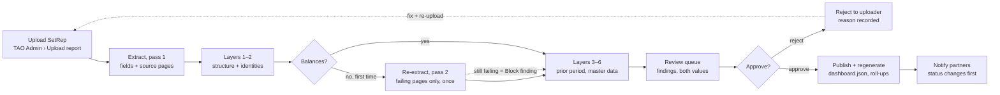

# SetRep Extraction Validation Strategy

Exported 2026-10-28 from the living doc (claude.ai/artifact/4cncE54X4z3PBBsnHH1jic). The doc is the source of truth; re-export after changes. Section "What the sample SetReps add" was appended at export time after reading the 12 sample reports.

## Why this matters

A SetRep (settlement report) drives covenant status, and covenant status drives what the investor and manager portals show. One wrong extracted number can flag a deal as triggered that is fine, or hide a real breach, and both are visible to outside parties within minutes of publishing.

CreditNova already solved the same shape of problem for financial statements: OCR and model extraction are never trusted on their own. Deterministic arithmetic identities (revenue − costs = gross profit, assets = liabilities + equity) run over every extracted set, failures escalate to a stronger model pass on the specific pages, and what still fails goes to a person. The strategy below applies that pattern to SetReps, where the identities are roll-forwards and ratio recomputations rather than P&L arithmetic.

The pipeline that produces today's deal pages already carries early versions of this: each deal's `dashboard.json` has `reconciles`, `balance_discontinuities`, `restatements` and `source_pages` fields. The gap is that these are computed after the fact and surfaced on a dashboard; nothing stops a bad extraction from being published, and nothing tells a TAO reviewer which number to look at.

## What a SetRep contains and what must agree

A SetRep is a closed system: almost every number is tied to another number on the same report, to last month's report, or to the facility agreement. That is what makes it checkable. The table lists the blocks the current `dashboard.json` already extracts and the relationship each one has to satisfy.

| Block | Fields extracted | Must agree with |
| --- | --- | --- |
| Tranche / facility balance | opening balance, advances, principal collected, prepayments, write-offs, closing balance | Roll-forward: opening + advances − principal − prepayments − write-offs = closing; closing = next period's opening |
| Contract counts | opening contracts, new, paid out, written off, closing contracts | Same roll-forward in units; closing = next period's opening |
| Aging | buckets (current, 31–60, 61–90, 91+), written-off bucket, bucket sum | Bucket sum = outstanding receivables; 91+ ÷ total = delinquency ratio as reported |
| Losses & recoveries | gross losses, actual and estimated recoveries, net losses, cumulative net losses (CNL) by vintage | Net = gross − recoveries; CNL this month = CNL last month + net losses; CNL ratio = CNL ÷ original balance of the vintage |
| Program & warehouse limits | program limit, program amount, warehouse limit, opening/closing advances, unused facility | Utilization = drawn ÷ limit; unused = limit − drawn; limits only change on an amendment |
| Enhancement & yield | total enhancement amount and %, original and current tranche yield, debt/equity, interest coverage | Enhancement % = enhancement ÷ tranche balance; coverage = interest income ÷ funding cost |
| Covenants | legal ref, description, current value, threshold, kind (ceiling/floor), status | Current value recomputes from the blocks above; status follows from value vs threshold and the watch buffer |
| Header | deal, program, collection period, settlement date, source file, source pages | Period is the month after the prior report; the deal and program match the facility record |

Two things are not derivable and have to come from a reference record rather than the report: the covenant thresholds and definitions (from the SLFA and amendments) and the program limits. Those belong in TAO Admin as master data, so a SetRep that states a different threshold is itself a finding.

## Six validation layers

Run them in order; each layer is cheaper than the next and catches a different class of error. A report has to clear layers 1–3 to be publishable at all; layers 4–6 produce findings a reviewer sees before publishing.

| Layer | Question it answers | Catches | Example |
| --- | --- | --- | --- |
| 1. Structural | Did we get every field, in the right type and unit? | Missing pages, wrong currency, percent vs decimal, thousands separators read as decimals | Delinquency ratio extracted as 179 instead of 1.79% |
| 2. Arithmetic identities | Do the numbers on this report agree with each other? | Mis-read digits, a column shifted by one row, a subtotal picked up as a line | Opening + advances − collections ≠ closing by $412,000 |
| 3. Cross-period | Does this report continue last month's? | Wrong file uploaded, wrong deal, restated prior month, duplicate period | Opening tranche balance ≠ prior closing; collection period already exists |
| 4. Cross-source | Does it agree with the facility record and the servicer's own totals? | Threshold or limit mis-read, amended facility not updated, program total ≠ sum of deals | CNL limit read as 3.5% but SLFA says 3.25% after the 2025 amendment |
| 5. Covenant recomputation | Do we get the same ratio and status the report claims? | A ratio computed by the servicer from numbers we read differently; a status flipped by rounding | Our CNL ratio 3.30% vs reported 3.03%, status changes from WATCH to OK |
| 6. Reasonableness | Is the movement plausible? | Correct arithmetic on wrong magnitudes (a 10× error that still balances), stale copies of last month | Tranche balance down 48% in a month with no prepayment recorded; every field identical to prior period |

Layer 1 and 2 failures are usually the extractor's fault and are the ones worth a second, targeted model pass on the specific source pages before anyone is involved. Layers 3–6 are usually the report's or the master data's fault and need a person. Keeping that distinction is what makes the review queue short.

## Rule catalogue

Start with these 22 rules. Severity decides what happens: **Block** means the report cannot be published; **Review** means it goes to the approval queue with the finding attached; **Note** is shown but does not stop publishing. Tolerances are rounding tolerances, not judgement calls: $1 per line on balances, 0.01 percentage points on ratios, zero on counts.

| # | Layer | Rule | Severity | On failure |
| --- | --- | --- | --- | --- |
| 1 | Structural | Every required field present, numeric, with a unit | Block | Retry extraction on the source pages; then reviewer |
| 2 | Structural | Currency on the report matches the facility currency | Block | Reviewer |
| 3 | Structural | Ratios in a plausible range (0–100%); no negative balances or counts | Block | Retry extraction; then reviewer |
| 4 | Structural | Collection period and settlement date parse, and period = prior + 1 month | Block | Reviewer (possible wrong file) |
| 5 | Arithmetic | Tranche balance roll-forward balances to within $1 | Block | Retry extraction on the balance page; then reviewer with the difference shown |
| 6 | Arithmetic | Contract count roll-forward balances exactly | Block | Same as 5 |
| 7 | Arithmetic | Aging buckets sum to outstanding receivables | Block | Same as 5 |
| 8 | Arithmetic | Net losses = gross − recoveries; CNL = prior CNL + net losses | Block | Same as 5 |
| 9 | Arithmetic | Unused facility = limit − drawn; utilization recomputes | Review | Reviewer |
| 10 | Arithmetic | Enhancement % and coverage ratio recompute from their components | Review | Reviewer |
| 11 | Cross-period | Opening balance and opening contracts = prior period closing | Block | Reviewer: accept as restatement (recorded) or reject |
| 12 | Cross-period | Period not already published for this deal | Block | Reviewer: replace (regenerate) or reject |
| 13 | Cross-period | Deal name and program on the report match the record the file was uploaded against | Block | Reviewer |
| 14 | Cross-source | Covenant thresholds equal the SLFA master record (incl. amendments) | Review | Reviewer; master data owner notified |
| 15 | Cross-source | Program and warehouse limits equal master record | Review | Same as 14 |
| 16 | Cross-source | Sum of deal tranche balances = program total on the program-level SetRep, if one exists | Review | Reviewer |
| 17 | Covenant | Each covenant value recomputes from extracted components within 0.01 pp | Review | Reviewer sees both values; ours is published only if they confirm |
| 18 | Covenant | Status (OK / watch / triggered) derived from value, threshold and buffer matches the report's own status | Review | Reviewer |
| 19 | Covenant | A status change from the prior period (any direction) | Note | Flagged on the review card; triggers the notification |
| 20 | Reasonableness | Month-on-month change in tranche balance, contracts or delinquency within the deal's historical band (e.g. ±3σ of the last 12 months) | Review | Reviewer |
| 21 | Reasonableness | Report is not byte- or value-identical to the prior period | Review | Reviewer (stale copy) |
| 22 | Reasonableness | Every extracted value has a source page reference, and a sample of them is re-read by the second model pass and agrees | Note | Confidence score shown on the review card |

Rules 5–8 are the SetRep equivalent of CreditNova's revenue − costs = gross profit and should be the first ones built; they catch most extraction errors on their own. Rules 14–15 need the master data to exist first (see Workflow).

## Workflow in TAO Admin

A report that fails the identities gets exactly one automatic second pass on the failing pages; anything still failing is a Block finding for a person, never a silent retry loop. Only an approved report regenerates the dashboards the partners see.

How this lands on the portal map:

| Step | Page in the map | What the page needs |
| --- | --- | --- |
| Upload | TAO Admin › Uploads › Upload report | Deal and period chosen before the file, so rules 4, 12 and 13 have something to check against |
| Extract + validate | system (no page) | Runs in the pipeline; writes findings alongside `dashboard.json` |
| Review | TAO Admin › Approval queue › Review report | Each finding as a card: rule, severity, our value, the report's value, the source page image; one-click accept as restatement, override with reason, or reject |
| Approve / reject | Review report › Publish to partner / Reject report | Reject records the reason and notifies the uploader; approve records who, when and which overrides were used |
| Publish | TAO Admin › Reports library › Regenerate dashboard | Regeneration is automatic on approval; the manual button stays for reprocessing |
| Master data | TAO Admin › Partner details › Program / facility record (new) | Covenant definitions, thresholds, limits, amendment dates; needed by rules 14–15 |
| Audit | TAO Admin › Audit log | Every override and restatement is an entry, because partners will ask why a number changed |

The decision points already in the map ("Did the upload pass validation?", "Approve or reject this report?", "Has a deal report been reprocessed since the dashboard was generated?") are the three forks in this flow, so nothing new is needed there beyond the Program / facility record page.

## Lift from CreditNova, build new

The pattern transfers; the rules do not. CreditNova's identities are statement arithmetic; a SetRep's are roll-forwards, bucket sums and ratio recomputations, and they depend on last month's report and a facility record in a way a P&L does not.

| Reuse as-is | Adapt | New for SetReps |
| --- | --- | --- |
| Rule engine shape: a rule = (fields in, predicate, tolerance, severity, message) evaluated over an extracted document; findings stored alongside the extraction, not inside it | The rule library: swap statement identities for the 22 rules above; keep tolerances as data, not code | Prior-period lookup: every run needs the deal's last approved `dashboard.json` |
| Escalation ladder: deterministic check → one targeted model pass on the failing pages → human | The second pass prompt: it asks for the specific cells that would make a roll-forward balance, with the page image, not a full re-extraction | Master data (program / facility record) with covenant definitions, thresholds, limits and amendment dates |
| Source-page provenance per value (CreditNova keeps page and bounding box; `source_pages` already exists here) | The review card: CreditNova shows statement line vs extracted; here it shows our recomputed ratio vs the servicer's, with the status each implies | Restatement handling: a prior period can legitimately change; the reviewer records it and the roll-up regenerates |
| Confidence scoring from agreement between passes | Reasonableness bands: CreditNova compares to industry ratios; here compare to the deal's own 12-month history | Program-level reconciliation across deals (rule 16) and the weighted utilization the dashboards already compute |

If the CreditNova rule engine is packaged as its own module in the monorepo, TAO Admin can import it and supply a SetRep rule set; if it is still inside the spreading code, pulling it out is the first task and benefits both products.

## Phasing, measures and open questions

Three phases, each shippable on its own. Phase 1 alone stops the worst failures from reaching a partner.

1. **Identities and the gate.** Rules 1–13 (structural, arithmetic, cross-period) as a blocking gate on upload, with the one automatic re-extraction pass. No new UI beyond a findings list on the existing upload result. Calibrate on the SetReps already processed: every rule should pass on reports we believe are right, and we should seed known errors to confirm each rule fires.
2. **Review queue and master data.** The Review report page with finding cards, override-with-reason, restatement handling, and the Program / facility record page that rules 14–18 read from. Audit log entries for every override.
3. **Reasonableness and reconciliation.** Rules 19–22, the deal's 12-month bands, program-level reconciliation, confidence scores on the review card, and the notification on status change.

Measures to track from phase 1:

| Measure | Target | Why |
| --- | --- | --- |
| Reports passing all Block rules on first extraction | ≥ 90% | Extraction quality; a drop points at a new report layout |
| Block failures resolved by the second pass without a person | ≥ 70% of failures | Whether targeted re-extraction earns its cost |
| Findings per report reaching the reviewer | Trending to < 2 | Review queue stays short enough to be read |
| Corrections found by partners after publishing | 0 | The number that matters |
| Time from upload to publish | < 1 business day | Rules must not become a bottleneck |

Open questions to settle before phase 1 is scoped:

- [x] Is the SetRep layout the same for every servicer? The three F-PIL 2.0 servicers (Moneda, Stride, Xpedite) use the same 16-page Excel template; MOVE Trust reports not yet seen.
- [ ] Where do the SLFA thresholds and amendments live today, and who owns keeping them current? (Page 14 of each report states the current ones.)
- [ ] Do we have a program-level SetRep from the trust (for rule 16), or only deal-level reports?
- [ ] What does the servicer do on a restatement: reissue the prior month, or adjust in the current one? This decides whether rule 11 blocks or notes.
- [ ] Is the CreditNova rule engine separable from the spreading module today?

## What the sample SetReps add (appended 2026-10-28)

The 12 sample reports (Moneda Capital, Stride Capital, Xpedite Leasing; settlement months May–August 2026) are Excel-generated PDFs, 16 pages, with a clean text layer. `pdftotext -layout` returns every table aligned, so extraction is table parsing from text plus Claude cell-to-field mapping; OCR is a fallback for pages with no text.

The report prints its own column formulas, which map directly onto rules 5–8 and 17:

| Page | Section | Printed identity | Rule |
| --- | --- | --- | --- |
| 2 | Funded Finance Contracts (NPV), per advance | k = b − c − d − e − i (closing NPV = opening − scheduled principal − prepayments − defaults − NPV adjustment); j = (f + g) / b × 12 | R05 per advance and on the Portfolio Balances total |
| 2 | Outstanding Contracts | o = m − n | R06 |
| 11 | Aging Summary per Pool | g = a + b + c + e; total must equal page 2 closing NPV | R07 |
| 11 | Loss and Recovery | e = c − d; totals row | R08 |
| 11 | Obligor Buy-Out | prepayment and default totals tie to page 2 columns | R08 cross-page |
| 12 | Aggregate Portfolio Performance (13-month history) | d = a − b − c; monthly delinquency, rolling 3- and 12-month loss ratios | R17; R11 (prior month's row is on this report) |
| 12 | Cumulative Losses by vintage | e = b − c − d; CNL ratio = e ÷ a | R08, R17 |
| 13 | Borrower data | leverage = indebtedness ÷ equity; coverage = EBITDA ÷ interest | R17 |
| 14 | Quantitative Tests and Triggers | each SLFA 9.1 test, its threshold, YES / NO | R14, R18 |

Conventions to build in from day 1:

- **Period naming.** The file named 202608 has settlement date 7 August 2026; its cover block says Collection Period August 2026 while every page header says "for reporting period July 2026". The existing pipeline labels this object `collection_period: "August 2026"`, so keep that convention (period = cover block = settlement month), store the reporting-period month alongside, and have rule 4 check the two are exactly one month apart.
- **Conditional thresholds.** SLFA 9.1(c) and (d) switch threshold with portfolio NPV (6% / 4% and 4% / 2.25% below and above $10M). Covenant definitions need a `threshold_rule`, not a single number.
- **Placeholders and prose.** `#N/A` rows in the loss report are stripped, never extracted; "Actions taken by Borrower" is kept as text on the deal page, never as data; the compliance certificate (page 16) is stored as a page image.
